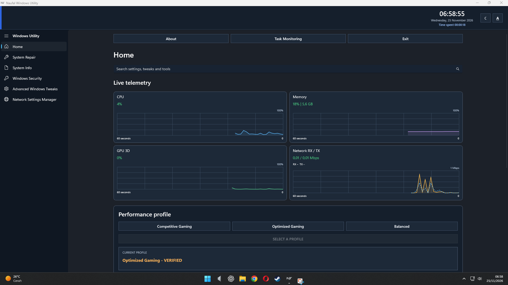

# Naufal Windows Utility

An open-source desktop app for Windows 10 and 11. Find a Windows tweak, check what it changes, and apply it from one place. The Home dashboard shows live CPU, memory, GPU and network activity.

**[Download v1.0.0.0 for Windows x64](https://github.com/mnaufalalauddin/Naufal-Windows-Utility/releases/download/v1.0.0.0/Naufal-Windows-Utility-Setup-1.0.0.0-x64.exe)** · [Release notes & checksum](https://github.com/mnaufalalauddin/Naufal-Windows-Utility/releases/latest)

| Light Mode | Dark Mode |
|:---:|:---:|
| [](docs/images/home-1.0-light.png) | [](docs/images/home-1.0-dark.png) |

## What you can do

- **Find a setting.** Search Home for `Game Mode`, `Copilot` or `DNS` to jump to the relevant tool. Inside Essential, Gaming and Advanced Tweaks, narrow the list by name or ON/OFF state.
- **Manage apps and startup.** Review built-in apps, open a desktop app’s registered uninstaller, or manage startup entries. [De-bloat Workspace guide](docs/debloat-workspace.md)
- **Repair Windows and inspect hardware.** Repair local Windows Update components, read a drive’s SMART health report, or check available GPU drivers, including NVIDIA GeForce Hotfix releases. [Disk health](docs/disk-info.md) · [GPU drivers](docs/gpu-driver-updates.md)
- **Configure your network.** Set IP addresses, gateways and DNS for Ethernet or a specific Wi-Fi network. [Network guide and supported configurations](docs/network-settings.md)

## Quick start

1. Download the x64 installer above. It is unsigned. Check its SHA-256 against `SHA256SUMS.txt` on the release page.
2. Install and open the app. Type a setting into **Search** on Home.
3. Review the current state, expected change and recovery options before applying a tweak. Some changes require a restart.

**Bahasa Indonesia** · Cari setelan dari Home, lihat statusnya, lalu tinjau perubahan sebelum menekan **Apply**. Antarmuka aplikasi menggunakan bahasa Inggris.

<details>
<summary>Build from source</summary>

On Windows x64, install the .NET 10 SDK, Visual Studio with WinUI and Desktop development with C++, the Windows SDK, and Inno Setup 7. From PowerShell 7 in the Visual Studio x64 developer environment, run the following in the repository root.

```powershell
.\build-installer.ps1
```

The installer is written to `artifacts\installer\`.

</details>

[Changelog](CHANGELOG.md) · [Report an issue](https://github.com/mnaufalalauddin/Naufal-Windows-Utility/issues) · [MIT license](LICENSE)
