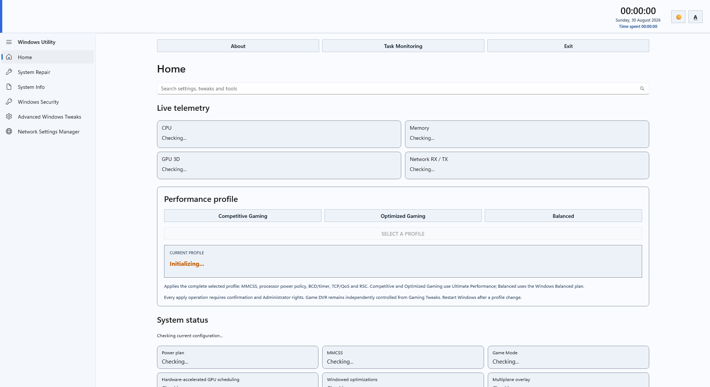
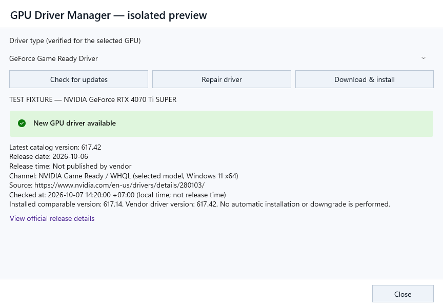
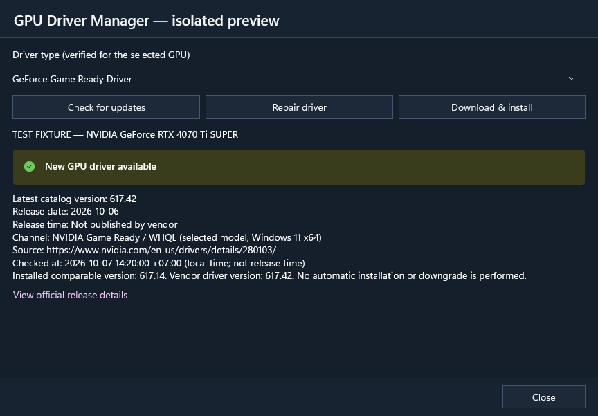

# Naufal Windows Utility

An open-source desktop app for Windows 10 and 11. Find a Windows tweak, check what it changes, and apply it from one place. The Home dashboard shows live CPU, memory, GPU and network activity.

**[Download v1.0.0.0 for Windows x64](https://github.com/mnaufalalauddin/Naufal-Windows-Utility/releases/download/v1.0.0.0/Naufal-Windows-Utility-Setup-1.0.0.0-x64.exe)** · [Release notes & checksum](https://github.com/mnaufalalauddin/Naufal-Windows-Utility/releases/latest)

| Light Mode | Dark Mode |
|:---:|:---:|
| [](docs/images/home-1.0-light.png) | [](docs/images/home-1.0-dark.png) |

## Explore the six menus

| Menu | What you can do |
| --- | --- |
| **Home** | Search `Game Mode` for its catalog row, `DNS WiFi` for the DNS field of the connected network, or `Startup Apps Manager` for the startup list. Watch live CPU, memory, GPU 3D and network charts, check your performance profile, or open Task Monitoring. |
| **System Repair** | Run Full Repair or Quick Repair, rebuild Windows Update caches, or troubleshoot Microsoft Store and Explorer. |
| **System Info** | Inspect disk health and SMART counters, export a system report, check Windows or Office activation, and see which tweaks share a setting. |
| **Windows Security** | Review protection status, BitLocker, automatic device encryption, Defender, Smart App Control and LSA protection. |
| **Advanced Windows Tweaks** | Search the Essential, Gaming and Advanced catalogs. Review built-in apps and startup entries, check GPU driver releases, inspect game runtimes or open MSI Mode Utility. |
| **Network Settings Manager** | Inspect active adapters, set Ethernet IP and DNS, or save settings for the connected Wi-Fi network on supported Windows builds. |

## Quick start

1. Download the **Windows 10/11 x64** installer above. It is unsigned. Compare its SHA-256 with `SHA256SUMS.txt` on the release page.
2. Open the app, review first-run prerequisites and search Home for the setting you want. Availability depends on your Windows build, edition and hardware.
3. Back up important data before making changes. Review the current state and recovery options, then confirm. For changes that recommend a restart, choose **Restart now** or **Later** after active tasks finish.

**Bahasa Indonesia** · Cari setelan dari Home, periksa status dan pilihan pemulihannya, lalu tinjau perubahan sebelum menekan **Apply**. Antarmuka aplikasi menggunakan bahasa Inggris.

## Feature guide

<details>
<summary><strong>Tweaks, performance profiles and recovery</strong> · What ON, OFF and Restore mean</summary>

In **Essential Windows Tweaks**, **Gaming Tweaks** and **Advanced Windows Tweaks & De-Bloat**, combine text search with **ON**, **OFF**, **Partially applied**, **Unavailable** or **Not verified**. ON means the *tweak* is applied. For example, turning on a removal tweak can remove the Windows feature named on the row. Bulk selection and restore operate on visible options. Use **All options** to find action-only tools such as **Review apps**.

Select a row to see its measured state, the proposed change and the recovery source. **Applied** and **Not applied** describe the current configuration. Some options can still restore a saved original when they show **Not applied**. A documented **Windows default** can differ from your previous choice, and restoring defaults can discard a saved original. After Apply or Restore, the catalog rereads the configuration. The tool window shows progress, verification and errors. Operation journals and conflict checks protect shared settings such as Advertising ID across catalogs.

**Competitive Gaming** and **Optimized Gaming** use Ultimate Performance. **Balanced** uses the Windows Balanced plan. Profiles also configure scheduling, processor power policy, boot timers and network settings. **Configuration verified (23/23)** means all 23 settings match the profile. In **Compare gameplay measurements**, enter the average frame time from two runs of the same scene and graphics settings to see the difference in milliseconds and percent.

**Installation and backups.** The default installation folder is `C:\Program Files\Naufal Tech's Limited\Naufal Windows Utility`. Preferences and some recovery files live under `%LOCALAPPDATA%\Naufal Windows Powertoys`; other snapshots are feature-specific or stored in the registry. If Setup reports a previous installation in a different folder, keep the backups, close the app and follow its relocation instructions.

</details>

<details>
<summary><strong>Built-in Windows Apps and De-bloat Workspace</strong> · Choose an app and understand the scope</summary>

Open **Advanced Windows Tweaks & De-Bloat → Built-in Windows Apps → Review apps**. Filter by **Installed**, **Not installed** or **Not verified**. Installed includes registrations marked **Needs repair**. Each list is alphabetical and includes removal guidance and counts. **Select visible** affects the filtered list. Store app operations target the current account; OneDrive follows its installation scope. Reinstalling an app can require WinGet, Microsoft Store or a valid license. It cannot recover deleted personal data.

| Workspace panel | Scope |
| --- | --- |
| Individual Windows AI controls | Review Copilot removal or recovery and individual Recall, Click to Do, Notepad AI and Paint AI policies. |
| Desktop / OEM apps | Inspect the publisher and registered uninstaller. After the vendor dialog closes, check whether Windows still lists the app. |
| Startup Apps Manager | Disable eligible current-user Run entries and restore their saved registration. Other entry types open Windows startup settings. |
| Per-app background controls | Restrict eligible packaged apps across accounts. Notifications and sync can be affected. |
| Reinstalled app detection | Compare installed apps with verified removal history and review any that returned. |
| Provisioned apps | Remove an eligible package from provisioning for **new accounts**. Existing users keep their installations. Recovery can require original packages or system media. |

[Workspace behavior, safeguards and recovery guide](docs/debloat-workspace.md)

</details>

<details>
<summary><strong>Windows Update Fix and security controls</strong> · What gets checked</summary>

For a stalled download, close Windows Update Settings and wait for any active installation to finish. **System Repair → Windows Update Fix** checks BITS, Windows Update and Cryptographic Services. It retains uniquely named backups of the caches it resets, including DataStore, Download and, when available, catroot2. If running dependencies prevent cryptsvc from stopping with error 1051, the limited path leaves catroot2 alone and reports **Partial repair**. Review or save the log, then use **Check for updates** in Windows Settings to retry the download. Back in the repair window, select **Check update activity** and look for your KB or update title in the events recorded since the repair finished. [VM repair evidence](docs/verification-20261015.md) · [Pause/Resume and partial repair](docs/verification-8.0.0.5.md)

**Windows Security** distinguishes configured protection from running protection. Memory Integrity (HVCI) is read-only here. LSA Enable has compatibility and policy checks; automatic LSA rollback is unavailable because registry state cannot establish whether a firmware lock persists. Keep your BitLocker recovery key securely. Changing automatic encryption policy leaves an already encrypted drive encrypted. [Security controls and recovery limits](docs/security-controls.md)

</details>

<details>
<summary><strong>GPU Driver Manager</strong> · Compatible channels, version history and GeForce Hotfix</summary>

Select a GPU to see its installed driver, compatible driver types and releases from the official vendor catalog. The panel distinguishes the **release date and time** from the **local check time**. Some vendors publish only a date. NVIDIA versions use their public form, such as **617.14**.

- **NVIDIA** offers Game Ready, Studio or workstation RTX/Enterprise channels where supported. GeForce Hotfix entries link to NVIDIA Support.
- **AMD** offers Recommended and Optional releases where the supported Radeon catalog supplies them. **Intel** Graphics and Arc Pro choices depend on the GPU family and published product list.
- **Qualcomm Snapdragon X** uses the version selector in Qualcomm Software Center.

**Check for updates**, **Repair driver** and **Download & install** share one header. Review the selected channel and version before confirming. Archived or manual-only entries open the vendor page. Offline, blocked or ambiguous catalog results are shown explicitly. OEM systems may require a customized driver. [GPU update guide](docs/gpu-driver-updates.md)

| Light Mode | Dark Mode |
| --- | --- |
|  |  |

*Driver panel previews use sample release data.*

</details>

<details>
<summary><strong>Disk health and system reports</strong> · SMART data and privacy</summary>

Choose a physical disk to see its model, firmware, temperature and available SMART evidence. NVMe reports can include endurance, spare capacity, critical warnings, power-on hours and media errors. ATA/SAT reports show available attributes and thresholds. Host read/write totals use decimal TB and retain the original counters in the report. When the controller supplies too little evidence, health is **Unknown**.

System Report hides local IPv4, IPv6 and MAC addresses by default. You can include them when copying or saving a report. Review exported reports for other identifying information before sharing them. Activation tools report Windows and Office status; activation requires a valid license. [Supported disk paths and limitations](docs/disk-info.md)

</details>

<details>
<summary><strong>Ethernet and per-SSID Wi-Fi</strong> · Addressing, DNS and supported builds</summary>

The adapter card shows the active connection. Edit IPv4 or IPv6, subnet mask or prefix, gateway and preferred/alternate DNS, then choose **Save to Windows**. Ethernet writes the edited sections and reads them back. On supported x64 Windows builds, Wi-Fi saves to the **connected SSID**. Unsupported builds keep Wi-Fi editing read-only and offer Windows Settings. Recovery snapshots preserve the original configuration.

Additional tools cover printers, computer/workgroup settings, network drives, WINS, routes, hosts and local programs/scripts. The SMTP check tests TCP connectivity. These actions have their own confirmations and recovery limits. [Network guide](docs/network-settings.md) · [Wi-Fi provider and build support](docs/wifi-ssid-provider.md) · [Tested configurations](docs/network-acceptance-status.md)

</details>

## Verification and development

<details>
<summary><strong>What has been tested?</strong> · Release checks, VM evidence and hardware limits</summary>

| Area | Evidence and remaining limits |
| --- | --- |
| Desktop and installer | The release includes the x64 Native AOT installer and its SHA-256 checksum. The isolated WinUI suite passed **47,316 assertions across 276 layout cases**, including small windows, text scaling and theme contrast. The suite uses isolated controls for interaction tests. |
| Profiles and apps | On one development PC, each of the three profiles passed 23 checks and an intentional rollback. A VirtualBox guest launched Chrome’s registered uninstaller and verified removal of its registration. Vendor uninstallers, AI runtime effects and startup behavior across sign-in need broader live coverage. |
| Windows Update | A VMware guest completed all six local repair stages and retained the cache backups. A separate Pause/Resume test completed a scan with no download offered. Recovery of an observed, previously stuck online download is still unverified. |
| Networking | Per-SSID IPv4/IPv6 addressing and rollback were exercised on one host across reconnects, two SSIDs and reboots. On the retained alternative DNS configuration, 12/12 Wi-Fi-bound DNS/HTTPS checks passed after reboot. The original router’s IPv6 DNS occasionally timed out. A VMware guest verified Ethernet IPv4 DNS Apply and exact rollback. Other network actions need separate live tests. |
| Disk controllers | NVMe and ATA reads were observed on available drives. Intel RST/RAID, ASMedia ASM2362 and Realtek RTL9210 paths have fixture coverage; verification on matching hardware is pending. |

Historical records also cover retired modules, including offline images and storage servicing. Those fixtures are excluded from the application build. [Changelog and test history](CHANGELOG.md) · [VM protocol](docs/vm-validation.md) · [Full earlier technical reference](https://github.com/mnaufalalauddin/Naufal-Windows-Utility/blob/14c0d6c7284e21303b36c406bc04ea5497a35410/README.md)

</details>

<details>
<summary><strong>Build from source and run tests</strong> · Windows x64</summary>

Install Git, the .NET 10 SDK, Visual Studio with WinUI and Desktop development with C++, the MSVC x64 tools, Windows SDK and Inno Setup 7. In PowerShell 7 with the Visual Studio x64 developer environment loaded, run:

```powershell
git clone https://github.com/mnaufalalauddin/Naufal-Windows-Utility.git
Set-Location Naufal-Windows-Utility
.\build-installer.ps1
```

The self-contained x64 installer is written to `artifacts\installer\`. For a Debug build and focused regression checks, run:

```powershell
dotnet build ".\Naufal Tech's Windows Powertoys.csproj" -c Debug -p:Platform=x64
dotnet run --project .\Tests\ProfileVerification\ProfileVerification.Tests.csproj
dotnet run --project .\Tests\Localization\Localization.Tests.csproj
dotnet run --project .\Tests\GpuUpdates\GpuUpdates.Tests.csproj
.\Tests\ParityAudit\Test-CatalogInteraction.ps1
.\Tests\ParityAudit\Test-ProjectIdentity.ps1
.\Tests\HeaderLayout\Test-HeaderLayout.ps1 -NativeAot -Languages en
```

The dashboard and dialogs live in `MainWindow.xaml` and `MainWindow*.cs`. Service and catalog files implement reads, changes and recovery. Packaging lives in `Installer/`; test suites live in `Tests/`. From a writable publish directory, the packaged executable’s `--capture-startup-check` option checks all six pages and live Home reads and saves Light/Dark screenshots with `startup-check/result.txt`. It requires administrator approval. Use a disposable VM for testing changes to Windows.

</details>

## Contribute

For a bug report, include the Windows build, app version, display language, selected option, steps to reproduce and relevant log lines. Remove identifying information, recovery keys and credentials before posting. Reproducible test cases, wording improvements and focused pull requests are welcome. [Report an issue](https://github.com/mnaufalalauddin/Naufal-Windows-Utility/issues) · [Pull requests](https://github.com/mnaufalalauddin/Naufal-Windows-Utility/pulls) · [Contributors](https://github.com/mnaufalalauddin/Naufal-Windows-Utility/graphs/contributors)

Developed by **Muhammad Naufal Alauddin**. Independent of Microsoft and Microsoft PowerToys. [MIT license](LICENSE) · [Third-party notices](THIRD-PARTY-NOTICES.txt)
